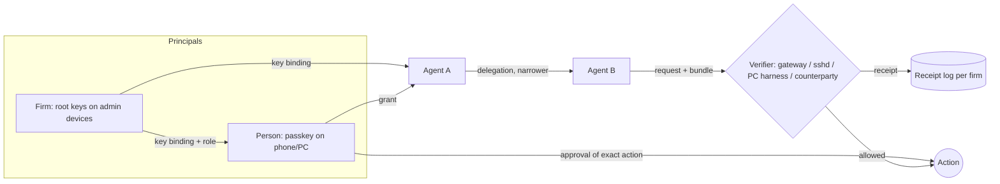

# AAP concept, November 2026: verifiable claims in large agent systems

- **Date:** 2026-11-12
- **Status:** concept for discussion. Nothing here is decided, and nothing here is to be built yet. The open questions in section 10 are for the maintainers.
- **Builds on:** the review in PR #13 (`docs/review-2026-11.md`), the design drafts `docs/design/0001`–`0006`, and the maintainers' decisions on that review on 2026-11-12.
- **What changed since the review:** the review proposed "human approval evidence for Wave" as the next milestone. The maintainers' answer widens the scope: AAP should make things *securely verifiable in large systems*, between agent and human just as much as between agent and agent. The milestone waits until the concept is finished. This document is that concept.

## 1. Summary

**The goal in one sentence.** In a system with many people, many firms and many agents, any party that has to rely on a claim about authority ("this agent may do this", "this human approved exactly this", "this happened within the limit") can check it from evidence alone, without trusting the agent, the platform in between, or Stonewave.

**The core idea: two planes.**

- **Policy plane.** Inside one trust domain (one Wave runtime and its database, one PC, one server), authority is enforced by policy: rights, approval levels and the rights intersection when one party calls another. This plane is fast, needs no cryptography per call, and already exists in Wave.
- **Evidence plane.** Whenever a claim *crosses a trust boundary* or *must survive a dispute*, it travels as signed evidence. Examples of the first kind are cloud to PC, Wave to a customer's server, firm to firm, and Stonewave to its customer. Examples of the second kind are a sent mail, a deploy, a payment, or a decision made in someone's name. AAP is the evidence plane.

**The rule that connects them.** Sign at trust boundaries and for critical actions, enforce by policy everywhere else, and write a receipt for every decision in both planes. "Critical" means what Wave's click rule (D-223) already calls critical: irreversible or leaving the firm.

**Six primitives** cover everything AAP needs to prove (section 4):

| Primitive | What it says |
|---|---|
| **Key binding** | This key belongs to this agent, device, person or firm. |
| **Grant** | This principal lets this actor do this, within these limits. |
| **Delegation** | This actor passes on part of its grant, and only ever a narrower part. |
| **Approval** | This human, on this device, approved exactly this action. |
| **Receipt** | This verifier decided this, and this was executed. |
| **Status** | Whether something is still valid or has been revoked. |

**Where AAP adds something.** The formats around AAP are largely taken: SD-JWT, the IETF mandate drafts, OAuth token exchange, AP2 for payments. AAP adds three things that nobody else covers:

- per-action human approval for non-payment actions, with a canonical rendering of what was approved;
- one deterministic verifier that evaluates a whole bundle (identity, firm role, grant, delegation chain, approval, budget, status) and always writes a receipt;
- the bridges into real enforcement points: the Wave gateway, SSH certificates on servers, and Elara's local harness on a PC.

**Recommended architecture (option B, section 9).** Keys sit on the devices of the people who have authority: passkeys, plus the admin-device CA that F-100 already designs for Systems. Wave relays and enforces but cannot mint authority on its own, and evidence can be checked offline. Formats are reused and mapped onto the IETF drafts at the edges; AAP keeps its own semantics and verifier.

## 2. What "securely verifiable" means here

A claim is **securely verifiable** when a party who did not witness it can check it later, from evidence alone, and every party that could fake it is either excluded or named:

1. **Independent.** The check does not trust the agent that presents the claim, and does not trust the intermediaries between the signer and the verifier: the Wave server, a relay, or Stonewave as operator.
2. **Specific.** The evidence names exactly what was allowed or approved: the action, the parameters, the limits and the time, and not just "agent X is trusted".
3. **Attributable.** Every statement is signed by a key, and the key is bound to a person, a device, an agent or a firm, at a stated assurance level.
4. **Bounded.** Authority can only shrink along a chain. Limits such as amounts, budgets, time and counterparties hold across the whole chain (cumulative evaluation), not just at its last link.
5. **Fresh and revocable.** The verifier can tell whether the evidence is current, single-use where needed, and not revoked.
6. **Recorded.** Every decision, accept or reject, produces a signed receipt that can be exported and checked offline.
7. **Fail closed.** Anything missing, unknown or hidden counts as "not allowed". The critical review finding A1 was a failure of exactly this rule.

**What "large systems" adds.** In a small system, one database and a few people can vouch for each other. A large system has many more of everything:

- many firms, each with its own rules (D-071);
- many agents per firm, which wake each other (D-213) and call each other with intersected rights (D-223);
- agents in several runtimes: Wave cloud, Elara Desktop, Claude Code sessions, Ace from outside over MCP;
- servers that belong to customers (D-240);
- long-running work.

As a system grows, more claims cross boundaries, more parties could be compromised, and disputes become more likely. Verification therefore has to be cheap, local and offline wherever possible. The one exception is budgets shared across verifiers, which need a single counter (section 6.5).

## 3. Which claims need to be provable, and to whom

### 3.1 The claim catalogue

| # | Claim | Typical verifier | Evidence (primitives) |
|---|---|---|---|
| K1 | **Agent identity:** this agent or key is agent A, operated by firm F | Any counterparty, gateway, server | Key binding signed by F (or by Wave for F) |
| K2 | **Human identity:** this key belongs to person P, at level L | Firm admin, counterparty, auditor | Key binding: passkey enrolment, firm attestation, EUDI wallet or passport chip (section 5) |
| K3 | **Role:** P holds role R in firm F (for example "may approve offers up to €1,000") | Gateway, counterparty | Key binding with a role claim, signed by the firm's key |
| K4 | **Authority:** principal P lets actor A do X within limits | Gateway, service, server, counterparty | Grant (an open mandate) |
| K5 | **Delegation:** A passed part of X to B, and only narrower | Same, plus anyone further down the chain | Delegation chain, with cumulative evaluation |
| K6 | **Approval:** human P approved exactly this action, having seen this rendering | Gateway, auditor, counterparty, the human later | Approval (a closed mandate signed by P's device key) |
| K7 | **Within limits:** this action keeps within amount, budget, time and counterparty limits | Verifier, budget authority | Grant, delegation and approval, plus the budget ledger |
| K8 | **Decision and outcome:** verifier V accepted or rejected this request under this policy, and it was executed with this result | Firm, auditor, dispute | Receipt (decision receipt plus execution receipt) |
| K9 | **Still valid:** none of the above is revoked or expired | Every verifier | Status (status list, short lifetimes) |
| K10 | **Provenance:** this message, file or post came from agent A, under grant G, approved by P | Recipient of a mail, offer, post or deploy artifact | Receipt reference attached to the artifact |

### 3.2 The four relationships

| Relationship | What the relying party asks | Claims | Stonewave example |
|---|---|---|---|
| **Agent ↔ human** | Human to agent: "what may you do for me, and what did you do?" Agent to human: "may I, and did you really approve?" | K4, K6, K8 | An employee approves an outbound mail; the CEO approves a production deploy; Elara writes on a person's PC from their iPhone |
| **Agent ↔ agent** | "Who sent you, with which rights, and which part of them may I act on?" | K1, K5, K7 | Maxwell hands work to Stella; the Leitstand starts worker sessions; Elara in the cloud hands a task to Elara Desktop |
| **Agent ↔ service** | "May this agent call me for this, and on whose behalf?" | K1, K4, K5, K9 | Ace operates a customer's server through Systems; an agent calls an MCP tool or an external API; a payment processor |
| **Firm ↔ firm** | "Is this really firm F, did a human with the right role approve this, and can I prove it later?" | K1, K3, K6, K8, K10 | A customer firm's sales agent sends an offer to its own customer; the customer's purchasing agent negotiates with a supplier's agent |

### 3.3 When a database record is enough

Signed evidence costs keys, user interface and operations. Section 2 makes it worth that cost in exactly four situations:

1. **A trust boundary is crossed.** The verifier does not share the issuer's database or trust its operator. Examples: Wave cloud and a PC, Wave and a customer's server, firm and firm, Stonewave and its customer.
2. **An insider must not be able to fake it.** The claim must hold even if the platform, an admin or a prompt-injected automation is compromised. For critical actions, "Wave says P approved" is weaker than "P's device signed this".
3. **It must survive a dispute or an audit.** The evidence outlives the system that produced it, or is shown to someone outside it.
4. **Budgets or limits span several verifiers.**

Everything else stays in the policy plane. That includes calls between agents inside one Wave runtime, rights intersection, and non-critical internal actions. They are enforced by policy and recorded as receipts, without per-call signatures. This keeps the system fast and matches "function before security mania".

## 4. The model

### 4.1 Parties

- **Principals** hold authority of their own. These are **persons** and **firms**. A firm acts through people in roles.
- **Actors** act on someone's behalf. These are **agents** (Elara, Maxwell, Stella, Ace, worker sessions), **devices** (a phone, a PC, an admin device) and **services**.
- **Verifiers** decide: the Wave gateway, `sshd` on a server, Elara's local harness, a counterparty's system, an auditor.
- **Trust anchors** are what a verifier trusts from the start, for example a firm's root keys, the EUDI trust list, or a passport issuer's country signing certificate. Each verifier has its own set.

### 4.2 The six primitives

All six are signed statements. Formats are reused (section 7): SD-JWT or JWS on the web, CBOR/COSE on constrained devices, SSH certificates for `sshd`. The meaning is AAP's own.

| Primitive | Signed by | Contains | Lifetime |
|---|---|---|---|
| **Key binding** | Firm key, Wave for the firm, the person's wallet, or AAP's own enrolment | Subject (agent, person, device), public key, assurance level, optional role | Months; revocable |
| **Grant** (open mandate) | A principal, or a person in a role for the firm | Actor, action kinds, constraints (amounts, budget, counterparties, time windows, data categories), expiry, approval level per action kind | Hours to months |
| **Delegation** | The holder of a grant | A narrower grant for another actor, linked to its parent | Short |
| **Approval** (closed mandate) | The human's device key: a passkey, the admin-device CA, or later a dedicated app | The canonical action (kind, parameters, hash), the rendering shown, approver, firm, risk class, expiry, single use | Minutes |
| **Receipt** | The verifier, and the executor for execution receipts | The request digest, the decision and reason, the policy version, the evidence digests, the time; for execution, the result | Permanent; hash-chained per firm |
| **Status** | The issuer of the statement | A revocation bit in a status list | Refreshed every few minutes |

### 4.3 Bundles and verification

An actor that wants to do something presents an **evidence bundle**:

- the request;
- the chain from a principal's grant through any delegations;
- an approval, if the action needs one;
- the key bindings for every signer;
- status references.

Verification is one deterministic function:

```
verify(bundle, trust_anchors, now, policy, ledger) -> Decision + Receipt
```

It checks every signature against a key bound by a trust anchor and evaluates the constraints of *every* link against the request (cumulative evaluation). It also checks the approval against the exact parameters, reserves the budget atomically, checks status, and writes a receipt for the result, accept or reject. The verifier in `aap-authority` already does most of this for one format (review, section 2.2). What is missing is the approval primitive, key bindings with roles, status lists, and an atomic budget reservation.



### 4.4 Invariants

1. **Only narrowing.** No link can grant more than its parent. This is checked at issuance and again at use.
2. **No human signature, no critical action.** An action the firm marks as critical runs only with an approval signed by a human-held key. A database record, a server key or an agent key is never enough.
3. **The operator cannot mint authority.** Stonewave and Wave relay and enforce, but hold no key that can create a grant or an approval for a customer. F-100 option B makes this a selling point for Systems; this concept extends it to everything.
4. **Hidden counts as absent.** Any constraint or status a holder does not disclose makes the verification fail; it never widens what is allowed.
5. **Every decision has a receipt.** Rejections carry no unverified attribution (review finding B5).
6. **Revocation is fast and local.** Grants and approvals are short-lived, and longer-lived keys are covered by a status list. Each firm has an emergency stop that revokes all of an agent's grants at once.
7. **Personal data is minimal.** Receipts carry digests and pseudonymous identifiers. Names, identity documents and full parameters are disclosed selectively, and only to the verifiers that need them.
8. **One click, not a dialog marathon.** Routine work runs on standing grants. A human signs only where the click rule asks for it today, and signing is the click itself (Face ID, Windows Hello or a fingerprint).

### 4.5 Assurance levels

These levels are carried as a claim in the key binding. A firm's policy states the minimum level per action kind.

| Level | Key holder | Example | Enough for |
|---|---|---|---|
| AL0 | Server or agent runtime key | Wave service key, agent key | Agent identity, internal receipts |
| AL1 | Software key on the person's device | Desktop app key without hardware | Low-risk approvals |
| **AL2-P** | **Passkey** (hardware-backed, biometric) | Face ID, Windows Hello, Android | **Default for critical actions** |
| AL2-A | Dedicated app key with platform attestation | Wave or Elara app with App Attest (R1 exists) | Critical actions where the app renders the action |
| AL3 | Key bound to a verified identity | Passkey bound via the EUDI wallet or the passport chip, or a qualified signature | Contracts, regulated actions, firm↔firm disputes |

**The honest limit of passkeys.** The screen that shows the action belongs to the app that asks for the signature. A compromised Wave front end could show one thing and have the passkey sign another. The mitigation:

- The WebAuthn challenge is the hash of the *canonical* action, so the signature binds to exactly those parameters. Anyone who later renders the evidence sees what was signed.
- Where that is not enough, AL2-A has the app render the canonical form itself, with a deterministic, non-model renderer (design 0002).

## 5. The identity layers

AAP does not run an identity system. It binds keys to identities that others provide, and states how strongly.

| Layer | What it proves | Source | When |
|---|---|---|---|
| **Device key / passkey** | Continuity: the same human-held key as last time, hardware-backed | WebAuthn on phone and PC; the Secure Enclave or TPM; the F-100 admin-device CA | **Now.** The base of everything |
| **Firm attestation** | Person P is our employee, in role R, with approval limit X | Signed by the firm's root key (its admins' devices), recorded in the blueprint | Now. Covers most of Wave |
| **EU wallet (EUDI)** | P is a specific natural person, state-verified (PID) | OpenID4VP presentation from the person's wallet, bound once to their passkey | When the wallets arrive (member states are due from 2026-12-24, with an uneven roll-out into 2027) |
| **Passport chip (fallback)** | P holds a genuine, state-issued document, and the chip is not cloned | ICAO 9303: Passive Authentication (the issuer's signature over the data groups), plus Active or Chip Authentication (a key inside the chip) | Universal fallback for people without an EUDI wallet, outside the EU, or before it arrives |
| **Firm identity** | F is a specific legal entity, and these keys speak for it | Company register number plus domain (DNS) now; later the vLEI (GLEIF) or the European Business Wallet | Domain and register now; the others when available |

### Passport chip as a universal fallback

The maintainers want the passport chip kept as a possible universal fallback. It is a good one, with three caveats the design must respect:

1. **It proves the document, not the person holding the phone.** Passive Authentication proves the data was issued by a state. Active or Chip Authentication proves the chip is genuine. Linking the document to the person at the screen needs a face match against the chip photo, which is biometric processing under GDPR Article 9. So the passport is used **once, at enrolment**: it binds the person's passkey (AL3), and after that the passkey signs. No passport data enters a grant, an approval or a receipt; they carry only a pseudonymous identifier and the level.
2. **Someone must hold the result.** The binding is signed by whoever checked the chip. That would be Stonewave as an identity issuer, with the liability, the data-protection review and the key protection that go with it. That is why the review deferred it. As a fallback, it can start narrow: the chip is read on the person's own phone, the person keeps the result, and Stonewave signs only "level AL3 reached, pseudonym X".
3. **Coverage is uneven.** Passports from almost all countries have chips, and modern phones read them over NFC. Chip Authentication is not universal, and some documents only support Active Authentication or neither. The verifier must record which checks actually passed.

The EU wallet is the preferred path where it exists, because a state stands behind the binding. The passport chip covers everyone else.

### Firm identity

Firm↔firm trust needs a firm key that a counterparty can tie to a legal entity:

- **Start:** a firm root key held by the firm's admin devices (several, so that losing one device does not lock the firm out). It is published under the firm's domain and linked to the company register number.
- **Later:** the **vLEI** from GLEIF already issues verifiable organisational and role credentials, and GLEIF is positioning them for AI agents (blog posts from August and September 2026, IETF individual draft `draft-hood-agtp-lei-00`, June 2026). The **European Business Wallet** (Commission proposal 2025/0358, 19 Nov 2025) is still in the legislative process. A Council general approach was scheduled for June 2026, but this review could not confirm the outcome. AAP should accept either as a trust anchor for a firm key, without depending on them.

## 6. How it maps onto Stonewave

### 6.1 Trust boundaries at Stonewave

| Boundary | Today | With AAP |
|---|---|---|
| Human ↔ Wave server | Approval record plus a 15-minute single-use ticket | Approval signed by the person's passkey for critical actions |
| Wave cloud ↔ PC (Elara Desktop, Wave on Windows with Outlook) | The PC trusts the authenticated connection | The PC harness checks the grant or approval before acting on cloud tasks |
| Wave ↔ customer server (Systems) | F-100 design: the admin device is a CA, with short-lived SSH certificates | The same model, with the certificates carrying AAP grants and approvals (6.3) |
| Stonewave as operator ↔ customer | Customers trust Stonewave | Stonewave cannot mint approvals or grants for a customer (invariant 3) |
| Firm ↔ firm | Plain mail | Receipt reference and firm key binding on outbound artifacts; later, agent-to-agent mandates |
| Outside text ↔ agent | Hard rule: outside text is never authority | Unchanged; outside text never becomes a grant |

### 6.2 Wave Sales

- **Outbound mail, offers, decisions in someone's name.** These are already critical under the click rule (D-223). The click card becomes the signing point: the human approves with a passkey over the canonical action, the gateway checks the signature against the stored parameter hash, and a receipt is written. Nothing visible changes for the user except Face ID or Windows Hello on the click.
- **Approval rules per firm** (D-071, for example "over €1,000: CEO or CFO"). This is a policy over roles. The gateway checks the approver's role binding (K3) against the firm's rule, so "the right person approved" becomes provable, not just "someone did".
- **Sending through the person's Outlook** (D-219). The PC is the executor. In step 2, the PC harness checks the signed approval before it sends over COM. That way a compromised cloud cannot send in the person's name.
- **Recipients** (K10). An optional verifiable reference in the mail ("approved by a person at Firm F, check here") is a later firm↔firm feature.

### 6.3 Wave Systems and Ace

F-100 already describes AAP, in SSH form:

| F-100 (Systems design) | AAP primitive |
|---|---|
| Each admin device is a CA, and Stonewave holds no CA key | Firm root keys on human-held devices; invariant 3 |
| Standing approvals ("Ace may read on the production server, logs and health, Mon–Fri"), auto-signed by the device | **Grant** |
| A click for critical commands, so the device signs a one-time certificate for exactly one command | **Approval** |
| A short-lived SSH certificate (at most 1 hour) "with the AAP rights and who gave the order" | A delegation rendered as an SSH certificate |
| Server logbook | **Receipts** |
| Lost admin device: Stonewave blocks it, and a second device removes it | **Status** and revocation |

**The recommendation is one model with two encodings.** The admin device signs AAP grants and approvals, and the SSH certificate is derived from them, with its extensions or critical options referencing the approval's hash. The server logbook writes AAP receipts. Then:

- Ace's work on servers;
- deploys through the Systems deploy view;
- and the CEO's "yes before production" in the factory

all produce the same evidence, which can be exported and checked offline.

Ace already docks into Wave over MCP with his own agent key (D-227). That key gets a key binding from the firm, and his rights come from grants, never from fixed keys on the server.

### 6.4 Entwicklung (development)

- **Merges and deploys.** At Stonewave, a merge may be automatic (D-071), and production needs the CEO's yes. A merge stays in the policy plane, with a receipt. A production deploy is critical and gets a signed approval, with the receipt in the release log. For customers, the default stays "never alone".
- **The Leitstand and worker sessions.** These are agent↔agent delegations, inside Stonewave's trust domain. They stay in the policy plane: the rule is "rights only shrink", and every spawn writes a receipt. They move to signed delegations only when sessions run in other trust domains, for example cloud sessions acting on customer repositories.

### 6.5 Marketing (Stella)

- **X posts without approval** (D-213). This is a standing grant, "Stella may post to X for Stonewave", with a rate limit and a budget. Each post gets a receipt and a provenance reference (K10).
- **Other content needs the CEO's approval.** That is a signed approval of the exact content hash. The weekly approval in F-116 is one approval over a batch: it lists the content hashes, and each post references the batch.
- **Budgets.** Ad spend and API costs across several verifiers need a single budget authority with atomic reserve and commit (review finding A6). It is the one central component in the design, and it holds no authority of its own: it only counts.

### 6.6 Elara as the user's layer

Elara is the person's agent across Time, Texter, Wave, the PC and the iPhone. She also runs in several trust domains: the cloud, the local harness on the PC (D-231 keeps it), and the phone. For AAP, that means:

- **Elara holds the person's grants.** She keeps the person's grants to her and to other agents and apps, the receipts of what was done, and the status of each. Think of it as a personal authority inbox: "what may act for me, what did it do, revoke it".
- **The person's devices are the approval devices.** The iPhone and the PC carry the passkey and, in the app, the admin-device CA. An approval from the phone for work on the PC (D-218 point 5) is a signed approval that the PC harness checks.
- **Elara must not be her own approval screen.** She is a model-driven agent. The approval card is rendered deterministically from the canonical action, never from model text, and the signature binds to that canonical form. Elara can explain and summarise next to the card, but the card itself is not hers.
- **Cloud Elara to Desktop Elara** is a trust boundary. A task from the cloud carries a grant, and the local harness verifies it before using its hands on the PC.

### 6.7 Agents of one firm talking to agents of another

This is the long-term case, and the one the IETF mandate drafts target. The flow:

1. The agent presents its key binding, signed by firm F with a firm identity anchor (5).
2. It presents a grant chain from a person in role R at F.
3. For a binding action such as an order, an offer or a contract, it also presents an approval at the level the counterparty's policy requires.
4. The counterparty's verifier writes a receipt.

AAP should present this in whichever IETF format wins, and contribute the approval profile (section 7).

## 7. Reuse, or where AAP adds something

| Need | Reuse | AAP adds |
|---|---|---|
| Token formats | SD-JWT (RFC 9901), Delegate SD-JWT, JWS, COSE, SSH certificates | Fail-closed handling of selective disclosure (A1), and one meaning across all encodings |
| Generic attenuating mandates | IETF individual drafts (`draft-hulea-wimse-agent-mandate-01`, `draft-niyikiza-oauth-attenuating-agent-tokens-02` and others), WIMSE AIMS | A shipped verifier with cumulative evaluation and receipts, and mapping onto whichever draft converges |
| Service access and token exchange | OAuth 2.x, Token Exchange (RFC 8693, with the `act` claim for actor chains), Transaction Tokens, ID-JAG, MCP authorization (spec 2026-07-28) and Enterprise-Managed Authorization | Not a replacement. AAP evidence can ride inside these, for example as `authorization_details` (RAR, RFC 9396) or a referenced approval |
| Agent and bot identity | Web Bot Auth, A2A signed agent cards, WIMSE workload identity | A key binding to a *firm* with a role, not just to a workload |
| Payments | AP2 and Mastercard Verifiable Intent (both now at FIDO) | Nothing new; interop only (done) |
| Human key | WebAuthn / passkeys; FIDO's agentic work (no output yet) | A canonical action rendering and an approval primitive for non-payment actions; adopt FIDO's profile once it exists |
| Person identity | EUDI wallet (PID via OpenID4VP); ICAO 9303 passport chip | One-time binding of a passkey to an identity level, without personal data in the evidence |
| Firm identity | Company register, DNS, vLEI, European Business Wallet (proposed) | Accepting any of them as an anchor for a firm root key; device-held firm keys |
| Revocation | IETF Token Status List | An emergency stop per firm and agent |
| Audit and transparency | Hash-chained logs; IETF SCITT (signed statements with transparency receipts), not re-checked for this concept | Receipts for every decision, an export bundle, and offline `aap verify` |

**AAP's own contribution, in short:**

1. The **approval primitive** for non-payment actions, with canonical rendering.
2. **One verifier** for whole bundles, with cumulative limits, fail-closed handling and receipts.
3. **Bridges into enforcement points:** the Wave gateway, SSH certificates, the PC harness.
4. A **composition profile** that says which evidence a verifier needs for which claim, at which level.

Everything else is reused.

## 8. Revocation, receipts, budgets and scale

- **Revocation.**
  - Approvals live for minutes and delegations for hours, so they mostly need no revocation.
  - Grants and key bindings are covered by a status list per issuer, which verifiers refresh every few minutes.
  - A lost device is revoked by any other device of the same person or firm admin (F-100, case 3).
  - An emergency stop per firm (or per agent) revokes all of that agent's grants in one status update.
- **Receipts.**
  - Every verifier writes receipts into a hash-chained log per firm, kept with the firm's data in Wave or on its own server.
  - An export bundle (the evidence plus the receipts) can be checked offline with `aap verify`.
  - Optional later: anchor the log's head in a transparency service, so that even the log's operator cannot rewrite history unnoticed.
- **Budgets.** Limits that span several verifiers need a counter with atomic reserve and commit. Lost state must read as "nothing left", never as "full budget" (review finding A6).
- **Scale.**
  - Verification is local and costs microseconds per signature.
  - Bundles are small (kilobytes), status lists are cached, and grants are reused across many actions.
  - The only central dependencies are the budget authority (only for actions with shared budgets) and the status refresh (which tolerates minutes of staleness by design).
  - Nothing requires a central online authority for each check.

## 9. Architecture options

### Option A: Wave as the central authority

Wave's server holds the keys, issues grants and approvals, verifies them and keeps the receipts. Humans click and the server signs.

- **For:** simplest to build; works with today's approval records; no device work.
- **Against:**
  - It proves only "Wave says so". A compromise of Wave, an admin or an automation can create approvals.
  - Customers must trust Stonewave with their authority, which contradicts F-100's own choice for Systems.
  - Firm↔firm evidence is weak.

### Option B: device-anchored evidence, Wave relays and enforces (recommended)

Humans and firm admins hold the signing keys on their devices: passkeys, and the admin-device CA from F-100. Wave stores, relays, renders the canonical form and enforces at the gateway, but cannot mint authority. Verifiers check offline, and receipts are kept per firm.

- **For:**
  - It meets invariants 2 and 3.
  - It is the model F-100 already chose for servers, so Systems and approvals share one design.
  - It extends to the PC and to firm↔firm without changes.
  - Passkeys make it one click.
- **Against:**
  - It needs device enrolment and recovery (several devices per admin).
  - Critical actions wait while no approval device is available.
  - Passkey rendering trust has the limit described in 4.5.

### Option C: wallet-native, fully decentralised

Every party holds verifiable credentials in wallets: EUDI for persons, Business Wallets for firms, and wallets for agents. Exchanges go peer to peer, with no Stonewave role.

- **For:** the most future-proof, and closest to where the EU is heading.
- **Against:** the wallets are not there yet (persons from late 2026 and unevenly, firms not yet legislated). There are no agent wallets, and the user experience is not ready for sales teams.

### The format strategy, orthogonal to the options

1. Build an own AAP token format: **no**. The format race is crowded.
2. **Use SD-JWT, JWS and SSH certificates internally, with AAP semantics and verifier, and map at the edges onto whichever IETF mandate draft and FIDO profile converge** (recommended).
3. Wait for the IETF: no, because Stonewave needs it before the standards settle.

### Recommendation

**Option B, with the format strategy 2, introduced along the two planes.**

- Keep the policy plane in Wave exactly as it is.
- Add the evidence plane at the boundaries in this order:
  1. Systems (F-100 already needs it);
  2. critical clicks in Sales;
  3. the PC harness;
  4. firm↔firm.
- Design B so that it can take EUDI and Business Wallet credentials as identity anchors (option C) later, without a redesign.

## 10. Open questions for the maintainers

Each question has a recommendation.

1. **Can Stonewave act in the name of its customers?**
   - (a) **No.** Approval and authority keys sit only on the devices of customers' people; Stonewave relays but cannot fake an approval. This is the same as F-100 for servers. **Recommended.**
   - (b) Yes, keys per firm in a Stonewave vault. Simpler, but "Stonewave can do anything" stays true.
2. **Where is signed evidence mandatory?**
   - (a) At trust boundaries and for everything the click rule calls critical; everything else by policy with a receipt. **Recommended.**
   - (b) Everything signed, including agent-to-agent inside Wave.
   - (c) Only when a customer asks for it.
3. **One model for Wave approvals and Systems server access?**
   - (a) Yes: F-100's certificates carry AAP grants and approvals, and the logbook writes AAP receipts. **Recommended.**
   - (b) Keep them separate.
4. **How do we know who a person is?**
   - (a) Passkey plus firm attestation by default. The EU wallet where available. The passport chip as a universal fallback, used once at enrolment, with no passport data in the evidence. **Recommended.**
   - (b) Passport chip as the main path.
   - (c) Passkey and firm attestation only, for now.
5. **How do firms prove who they are to each other?**
   - (a) Start with a firm key on the admins' devices, tied to domain and company register number. Accept vLEI and the EU Business Wallet when they are ready. **Recommended.**
   - (b) Wait for the EU Business Wallet.
6. **What role does Elara play?**
   - (a) Elara keeps each person's grants and receipts and is the approval inbox across apps. The approval card itself is rendered fixed, not by the model. **Recommended.**
   - (b) A separate approval app, with Elara staying out of approvals.
7. **Where does building start, once the concept is accepted?** No building until the maintainers say so.
   - (a) Systems first: Ace's critical server commands as signed approvals, since F-100 needs exactly this. **Recommended.**
   - (b) Sales first: signed approvals for outbound mail.
   - (c) Elara first: the PC harness checks tasks from the cloud.

## 11. What this changes in the review's roadmap

- **W0** (fixes, freezing v0, hardening v1) stays as it is.
- **W1** is no longer fixed to "Wave approvals in Sales". It becomes "the approval primitive at the first boundary", where question 7 picks the boundary.
- **W2** (status and assurance levels) gains key bindings with roles and firm root keys.
- **W3** (standing grants) is where Stella's and Ace's standing permissions land.
- **W4** (cross-domain) covers the PC harness and firm↔firm.
- **The passport chip** moves from "defer" to "**keep as the designed fallback, build later**", following the maintainers' answer.
- **Public engagement** with the IETF and FIDO comes after the concept, and only with the maintainers' yes.

## Sources checked for this concept (2026-11-12)

These are in addition to the landscape table in the review (section 4).

- European Business Wallet: [proposal 2025/0358 feedback page](https://digitalpolicyalert.org/event/38420-european-commission-closes-feedback-period-on-regulation-on-the-establishment-of-european-business-wallets-2025838-final), [Council presidency note ST 9684/26](https://data.consilium.europa.eu/doc/document/ST-9684-2026-INIT/en/pdf), [Austrian Parliament EU file](https://www.parlament.gv.at/gegenstand/XXVIII/EU/56969). These are secondary or procedural sources, and the outcome of the June 2026 general approach was not confirmed.
- vLEI and agents: [GLEIF, "Why AI agents need verifiable organizational identity"](https://www.gleif.org/en/newsroom/blog/why-ai-agents-need-verifiable-organizational-identity), [GLEIF on agentic payments](https://www.gleif.org/en/newsroom/blog/when-ai-agents-transact-who-stands-behind-them-why-verifiable-organizational-identity-is-critical-to-agentic-payments), [`draft-hood-agtp-lei-00`](https://datatracker.ietf.org/doc/draft-hood-agtp-lei/) (individual draft, June 2026).
- Passport chip: ICAO Doc 9303 (Passive, Active and Chip Authentication). The vendor overviews used for phone support are secondary, for example [IDTechWire](https://learn.idtechwire.com/technologies/document-verification-nfc).
- Stonewave context (internal, read-only): D-015, D-071, D-213, D-218, D-219, D-223, D-225, D-227, D-231, D-240, F-100 and F-118 on the wave-corporate board.
